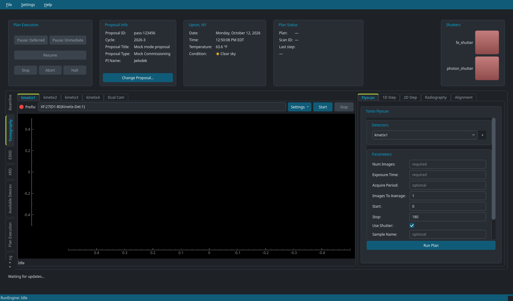
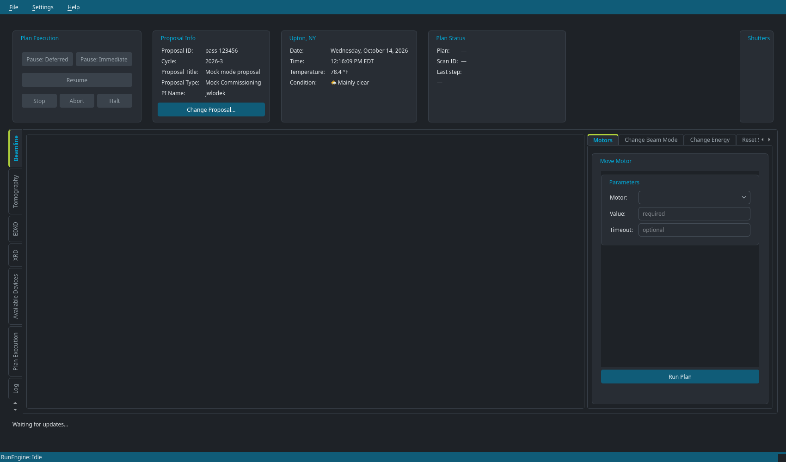
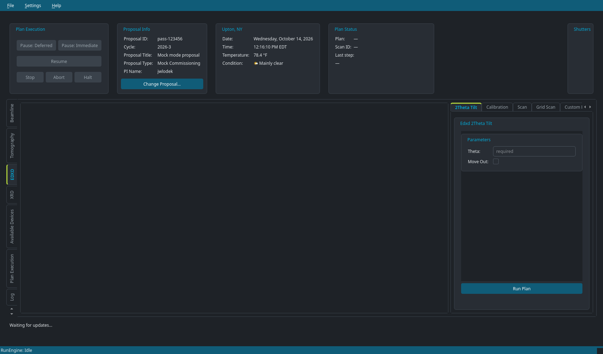
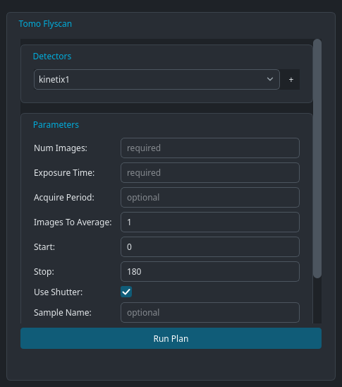
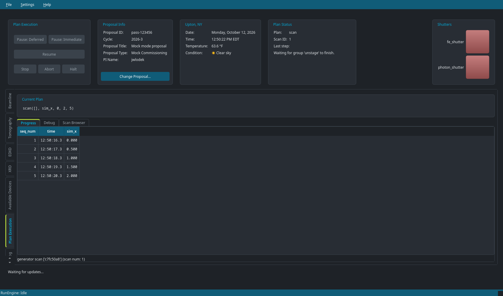
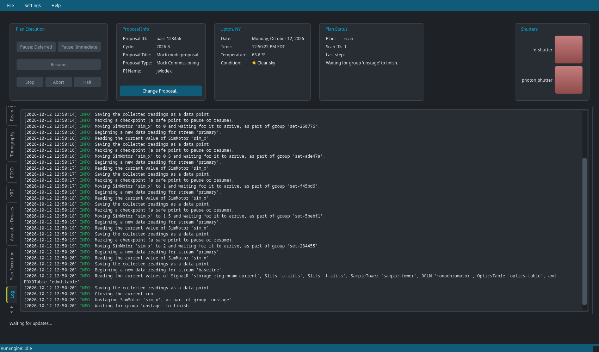
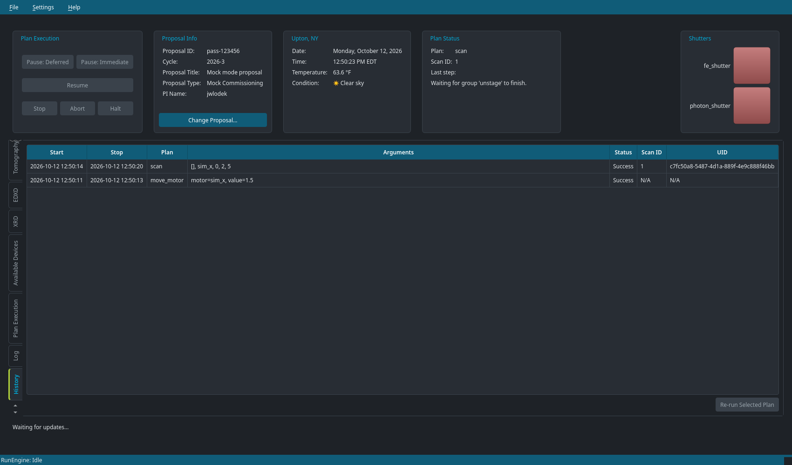
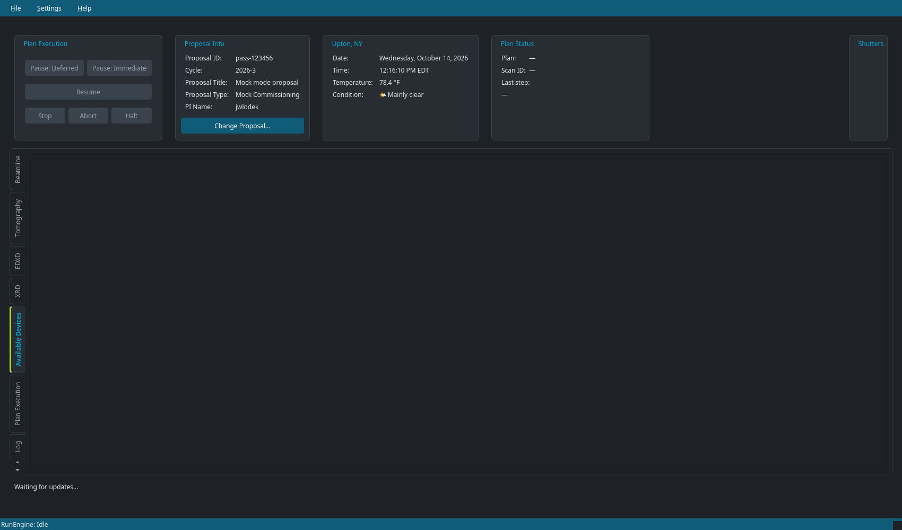

# Running plans from the GUI

The **HEX Data Acquisition** GUI generates a form for each beamline plan,
shows live detector images, and tracks every plan you run. It can run plans in
two ways:

- **In-process (local) mode** — the default. The GUI starts an IPython session
  on the [collection profile](profile.md) and attaches itself to it. Plans run
  in that session's RunEngine, exactly as if you had typed `RE(plan(...))` at
  the prompt.
- **Queue Server mode** — the GUI connects to a Bluesky Queue Server over HTTP
  and *submits* plans to its queue instead of running them itself.

## Starting the GUI

```bash
pixi run hex-gui          # in-process mode, real hardware
pixi run hex-gui-mock     # in-process mode, simulated devices
```

The `hex-gui` task runs `python -m hextools.gui`, which accepts these options:

| Option                    | Meaning                                                                                  |
| ------------------------- | ---------------------------------------------------------------------------------------- |
| `--mock`                  | Use simulated devices (sets `HEXTOOLS_RUNNING_IN_CI=YES`).                               |
| `--profile NAME`          | Profile to load in in-process mode (default `collection`).                               |
| `--queueserver-uri URI`   | Run in Queue Server mode against the HTTP server at `URI` (e.g. `http://localhost:60610`). |
| `--history-file PATH`     | JSON file to save plan history to, and reload it from on startup. Also settable with `HEXTOOLS_PLAN_HISTORY_FILE`. |

In in-process mode the terminal you started the GUI from becomes a normal
IPython prompt connected to the same session. You can keep typing commands
there while the GUI is open; plans run from the GUI are echoed in the terminal
with a `[GUI]` prefix and added to the IPython history, so you can recall and
edit them with the up arrow.

## Window layout



The window has four areas:

1. **Top row** — always visible, whichever tab is selected.
2. **Tabs on the left edge** — one per technique, plus tabs for devices,
   execution, logs and history.
3. **Progress bars at the bottom** — one bar per device the RunEngine is
   waiting on (e.g. a motor moving, a detector acquiring).
4. **Status bar** — the RunEngine state (`Idle`, `Running`, `Paused`).

### Top row

| Panel              | What it does                                                                                                                                                    |
| ------------------ | --------------------------------------------------------------------------------------------------------------------------------------------------------------- |
| **Plan Execution** | Pause (deferred or immediate), Resume, Stop, Abort and Halt the running plan. These do the same as `Ctrl+C` and `RE.resume()` etc. at the prompt.               |
| **Proposal Info**  | The active proposal, cycle, title, type and PI. **Change Proposal…** switches proposals (see below).                                                             |
| **Weather**        | Current conditions at the beamline.                                                                                                                             |
| **Plan Status**    | The running plan, its scan ID(s), and the last step it reported. When a plan runs another plan internally (e.g. a step scan running flyscans), both are shown. |
| **Shutters**       | One button per shutter: green when open, red when closed. Click to toggle; both controls are disabled until that action finishes, and whenever the RunEngine is busy or paused. |

Shutter controls wait for actual completion; manual button actions skip the
extra settling sleep, while acquisition plans retain their settling delays.
The slow photon shutter and faster front-end shutter do not share a fixed timeout.
After a pause, use the execution controls to resume or abort before actuating
another shutter. Errors are reported and controls become available when the
RunEngine returns to idle.

In the local **Beamline → Slits** form, choosing a slit device loads its actual
horizontal/vertical center and gap into the target fields without blocking the
GUI. Targets are disabled while reading; a failed read leaves them blank rather
than displaying another device's values. Select another device and back to retry.
Switching devices discards late results from the previous selection.
**Relative** uses zero offsets, not the absolute readbacks; unchecking it reloads
current positions. These are selection-time snapshots, not continuously updated
readbacks. Queue Server mode cannot read local devices and keeps optional
targets blank.

On the EDXD scan and custom-position grid forms, **Save as TIFF** starts checked.
Uncheck it to request HDF5 instead. This is a GUI default only; the Python plan
defaults are unchanged.

### Menus

- **File → Change Proposal…** — same as the button in the Proposal Info panel.
- **File → Save Plan History As…** — export the History tab to a JSON file.
- **Settings → Dark Mode** — switch between the dark and light themes. The
  choice is remembered.
- **Help → About** — Python and package versions.

## Technique tabs

### Beamline



Live views of the visible-light cameras (sample camera, F-hutch camera,
diamond window and fluorescence screen cameras), and plans to move motors,
change the beam mode and change the energy.

### Tomography

Live views of the four Kinetix detectors, including a **Dual Cam** view that
shows two detectors side by side, and the tomography plans: **Flyscan**,
**1D Step**, **2D Step**, **Radiography** and **Alignment**.

### EDXD



The GeRM detector's spectra and the energy-dispersive plans (2θ tilt,
calibration, scan, grid scan, custom position list, count and test pulse
configuration).

The tilt form labels the existing `theta` argument **Two theta**.
Every EDXD acquisition plan enables GeRM `stats1.enable_callbacks` and
`stats1.compute_statistics` before acquiring, even if IOC Autosave restored
them disabled. This does not change the detector's file format or data keys.

By default, 1D/grid/custom-grid scans restore their **pre-scan** motor positions
on success, failure and RunEngine abort, not the first scan point.
`reset_position=False` (or `reset_positions=False` for the custom grid) opts out.
Calibration restores its initial sample-tower Z1 position and velocity.
Pausing leaves a scan at its interrupted position until resumed or terminated;
intentional moves such as **Two theta** are not scans and retain their targets.
RunEngine **Halt** deliberately bypasses plan cleanup and cannot promise a
position reset. A failed/disconnected motor can also prevent restoration; such
errors are not suppressed.

### XRD

The live Perkin Elmer area detector image.

### Detector viewers

Each detector view shows the detector's live image stream (an NTNDArray over
PV Access). Use **Start** and **Stop** to acquire outside of a plan, and the
**Settings** menu to adjust the viewer. The indicator next to the PV prefix
shows whether the viewer is receiving images.

## Running a plan



Each plan tab is a form built from the plan's signature:

- **Numbers, text and checkboxes** for the plan's scalar parameters. Required
  fields show `required`; optional fields are pre-filled with the plan's default
  value, or show `optional` if the default is empty.
- **Drop-down lists** for parameters with a fixed set of values (e.g. beam mode).
- **Device selectors** for parameters that take a device. Only devices of the
  right type that exist in the session are offered. A parameter that takes a
  *list* of devices (like **Detectors** above) has a **+** button to add more
  rows.
- Comma-separated text for list parameters such as positions.

Supporting devices that the plan finds on its own (the PandA, rotation stage,
shutters, ...) are not shown on the form.

Hover over a field's label to see the description from the plan's
documentation.

Press **Run Plan**. The GUI checks the inputs, then runs the plan. If an input
is invalid, or the plan fails, a message explains why. While the plan runs, the
top row, the progress bars and the **Plan Execution** tab update live.

In Queue Server mode the button reads **Submit to Queue** and adds the plan to
the queue shown at the bottom of the window; start the queue from the queue
controls in the top row.

## Following a plan

### Plan Execution



Shows the command for the current plan and three sub-tabs:

- **Progress** — a live table of the data points collected so far.
- **Debug** — every step the RunEngine takes, color-coded by level.
- **Scan Browser** — search past runs in Tiled by type and date, inspect their
  metadata, and run actions on them (for example, analysing an alignment scan).

### Log



A plain-language account of what each plan did ("Moving SimMotor 'sim_x' to
0.5 and waiting for it to arrive…"), plus any warnings (e.g. a pause) and
errors.

### History



Every plan run in this session, from the GUI or the terminal: start and stop
times, the plan and its arguments, whether it succeeded, and its scan IDs and
uids. Select a row and press **Re-run Selected Plan** to run it again with the
same arguments. Use `--history-file` to keep the history across sessions.

### Available Devices



Every device in the session, its type, and whether it is connected. Aliases of
the same device (e.g. `monochromator`, `dclm` and `mono`) are listed together.

## Changing the proposal

Click **Change Proposal…** (or **File → Change Proposal…**). The dialog lists
the beamline's proposals for the current cycle; tick **Commissioning** to list
commissioning proposals instead, or type a number that isn't listed. The
proposal's title, type and PI are shown so you can check it is the right one.
Enter your BNL username and password and press **OK**. The switch runs
NSLS-II's `sync-experiment`, which checks that you are on the proposal; if it
refuses, the reason is shown.

In mock mode any username and password are accepted.
